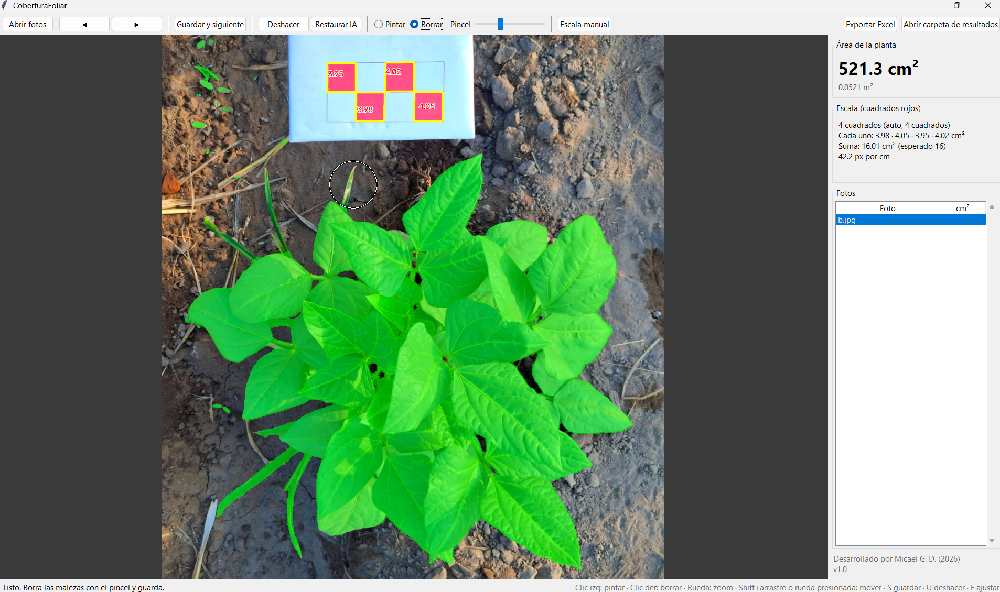

# CoberturaFoliar
 
Mide cuánta superficie cubre una planta en una foto, en **cm² y m²**.
 
Tomas una foto desde arriba, con cuatro cuadrados rojos de 2 × 2 cm junto a la planta. La app reconoce
la planta, tú corriges con un pincel lo que haga falta (por ejemplo, borrar malezas) y obtienes el área.
Funciona en Windows y no necesitas instalar nada más.
 

 
## Descargar
 
1. Entra a la sección **Releases** (columna derecha de esta página) y descarga `CoberturaFoliar.zip`.
2. Descomprímelo en cualquier carpeta y abre `CoberturaFoliar.exe`.
Requiere Windows 10 u 11 de 64 bits. Si Windows muestra «Windows protegió su PC», pulsa
**Más información → Ejecutar de todas formas**: pasa porque el programa no está firmado digitalmente.
 
## Cómo tomar las fotos
 
Para que la medida sea buena, importa más la foto que el programa:
 
- **Desde arriba**, con la cámara lo más recta posible.
- **Cuatro cuadrados rojos de 2 × 2 cm** (4 cm² cada uno) a la vista, sin hojas encima. El programa funciona
  si detecta al menos 2.
  - En la carpeta `docs` de este repositorio está **[escala.pdf](docs/escala.pdf)**, una hoja con los
    cuadrados rojos ya dibujados. Puedes imprimirla y usarla como referencia.
  - **Imprímela a tamaño real** (100 %, sin «ajustar a la página») y comprueba con una regla que cada
    cuadrado mide 2 cm de lado. Si salen más grandes o más chicos, el área saldrá mal.
- **La misma altura de cámara** en todas las fotos, y los cuadrados a una altura parecida a la de las hojas.
- Luz pareja y sin sombras fuertes.
Dentro del zip hay una carpeta `ejemplos` con fotos para probar.
 
## Cómo usarla
 
1. Pulsa **Abrir fotos** y elige una o varias.
2. Espera unos segundos. La zona verde es lo que el programa cree que es planta.
3. **Revisa la escala:** los contornos amarillos deben caer sobre los cuadrados rojos y cada uno debe
   marcar cerca de 4.00 cm². Si no los detecta, pulsa **Escala manual** y haz clic en las 4 esquinas de uno.
4. **Corrige con el pincel:** clic izquierdo pinta, clic derecho borra. El área se actualiza al instante.
5. Pulsa **Guardar y siguiente**.
Los resultados se guardan junto a tus fotos, en una carpeta `resultados_medir/`:
 
- `resultados.xlsx`: nombre de la foto, área en cm² y área en m².
- Una imagen `<foto>_area.jpg` por cada foto, con el contorno y el área escrita en rojo.
Si más tarde mides otras fotos de la misma carpeta, el Excel se conserva y se actualiza.
 
### Controles
 
| Acción | Cómo |
|---|---|
| Pintar / borrar | Clic izquierdo / clic derecho |
| Tamaño del pincel | Deslizador, o teclas `+` y `-` |
| Deshacer | `U` o Ctrl+Z |
| Volver a la máscara automática | `R` o botón «Restaurar IA» |
| Zoom | Rueda del ratón |
| Mover la foto | Shift + arrastrar, o botón central |
| Ajustar a la ventana | `F` |
| Guardar y pasar a la siguiente | `S` |
| Foto anterior / siguiente | Flechas ← → o la lista de fotos |
 
## Cómo funciona
 
1. **Mide la escala.** Cada cuadrado rojo mide 4 cm². Si en la foto ocupa, por ejemplo, 2 700 píxeles,
   entonces 1 cm² son 675 píxeles. Eso convierte cualquier medida de píxeles a centímetros.
2. **Reconoce la planta.** Un modelo de inteligencia artificial marca en la foto qué píxeles son vegetación.
3. **Tú corriges.** Borras lo que no quieres medir. Los cuadrados rojos nunca cuentan como planta.
4. **Calcula el área.** Píxeles de planta ÷ píxeles por cm² = área en cm².
## Limitaciones
 
- **Mide toda la vegetación.** Si hay malezas, aparecen en verde y debes borrarlas tú.
- **Perspectiva.** Las hojas más altas que los cuadrados rojos se ven más grandes en la foto, y el área sale
  algo mayor que la real. Mantén los cuadrados a la altura de la planta y la cámara siempre a la misma altura.
- **Revisa siempre la escala.** Que los cuatro cuadrados sumen 16 cm² confirma que se detectaron bien, no que
  la medida sea exacta.
© 2026 Micael G. D. Todos los derechos reservados.
